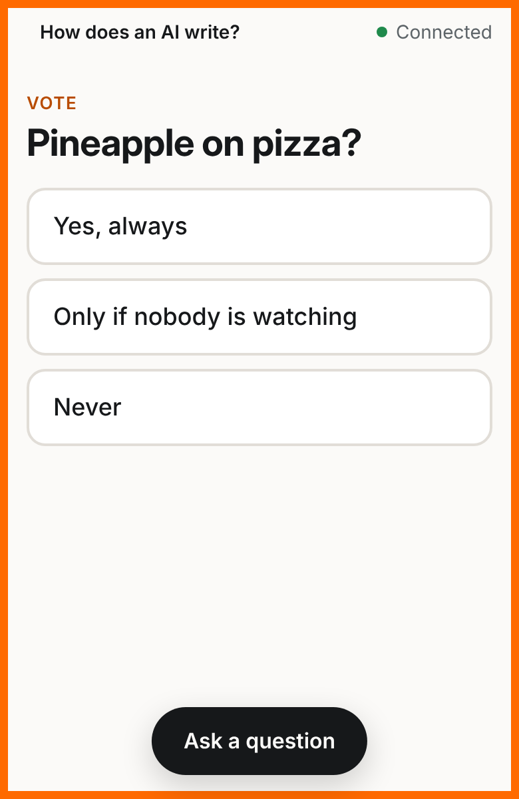
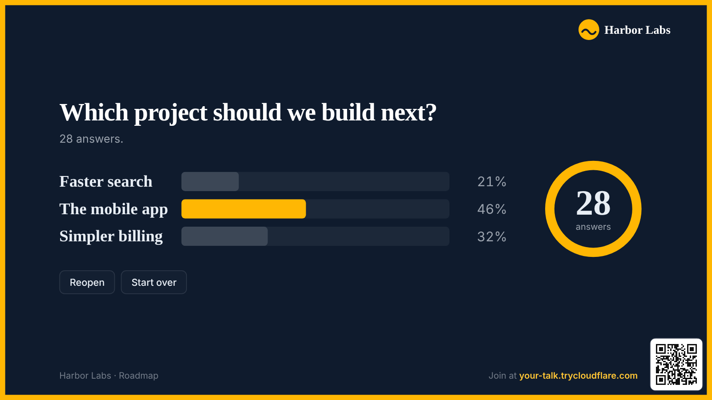

# Quorum

**Presentations where the audience takes part.**

Write your talk in Markdown. People scan a QR code and vote, guess numbers, write a sentence together, send questions and play with whatever you build. Results land on your slides as they arrive. Everything runs from your laptop: no accounts, no cloud service, no app to install.

**[Try the demo in your browser](https://jboixcampos.github.io/quorum/demo/)** (seven slides with a simulated audience), or write a slide in the **[playground](https://jboixcampos.github.io/quorum/playground/)** and see it live.

```markdown
::: poll {#lunch} Where should we go for lunch?
- Tacos
- Ramen
- [x] The place with the long queue

The queue is long for a reason.
:::
```

That is a whole slide. Press → to open voting, → to close it and show the results, → to reveal the answer.

## Why

Slides went from overhead projectors to PowerPoint to the browser, and the audience stayed in the same place: watching. Audience response tools exist, but they live in a separate tab, with their own account, their own design and their own copy of your questions. Quorum puts the interaction *inside* the presentation. A poll is a slide. A guessing game is a slide. A model running on your laptop that the audience steers is a slide.

## Quick start

You need [Node.js](https://nodejs.org) 18 or newer.

```bash
npm install -g github:JBoixCampos/quorum

quorum new my-talk          # a starter talk that shows every feature
quorum preview my-talk      # see it with a simulated audience, as you edit
quorum live my-talk         # give it
```

`quorum live` starts a small server, opens a public link with [cloudflared](https://developers.cloudflare.com/cloudflare-one/connections/connect-networks/downloads/) (or ngrok) if you have it, shows the QR code on your slides, and opens two windows: the presentation, to share or project, and your panel.

## One talk, three views

| What the room sees | What you see | What each phone sees |
| --- | --- | --- |
|  |  |  |
| The presentation window, shared or projected. Results land as they arrive. | Your panel: a clickable preview, the next slides, notes, the clock and questions to approve. | Only the question of the moment, after scanning the QR code. |

## What is in the box

| Block | What the audience does | On screen |
| --- | --- | --- |
| `::: poll` | Pick one option | Live bars, optional right answer |
| `::: multi` | Pick several | Live bars |
| `::: estimate` | Guess a number | Every guess as a dot, the average, then the real answer |
| `::: rounds` | The same question over a list | One result per round |
| `::: sentence` | Write a sentence one word at a time | The sentence growing, like a language model |
| `::: questions` | Ask and upvote, anonymously | Approved questions, most voted first |
| `::: component` | Whatever you build | Whatever you build |

Plus the usual slide things: steps that appear one click at a time, columns, big numbers, callouts, images, tables, code, speaker notes, sections with a pace clock.

**Your brand**: accent, primary, secondary, background and text colours, a logo on every slide and on phones, your own fonts, your own footer, image or colour backgrounds per slide, and a stylesheet for anything else. See [the talk format](docs/format.md#your-brand) and the [example](examples/brand/talk.md).



**The panel** is the presenter view: a live preview you can click, the next slides, your notes, how many people are in, the questions waiting for approval, and how you are doing on time.

**`quorum preview`** shows the talk with 24 simulated people who join, vote and ask, so you see every slide the way it will look with a room. It updates as you edit `talk.md`.

**`quorum build`** turns a talk into a static site that anyone can click through, with the same simulated audience. The [demo](https://jboixcampos.github.io/quorum/demo/) is one. Add `?slide=3` to its address to open it on a given slide.

**`quorum export`** is the fallback for when nobody can join: the same talk without the slides the audience answers, ready to present from any static web server.

## Build on it

A component is one JavaScript file next to your talk. Add `audience:` to its block and phones get a text box, a number field or a list of options; your component receives the answers and draws them however it likes.

```markdown
::: component word-cloud
audience: text
prompt: One word: how do you feel about AI?
:::
```

```js
// components/word-cloud.js
export default {
  mount(el, ctx) {
    const paint = (c) => {
      el.textContent = (c.answers.values || []).join(' · ');
    };
    paint(ctx);
    return { update: paint };
  },
};
```

Quorum takes care of the rest: opening and closing, the QR code, one answer per phone, simulated answers in the preview, and keeping the shared window and your panel in sync.

The [examples](https://jboixcampos.github.io/quorum/examples/) include a word cloud and a **next-word explorer** that asks a language model running on your laptop (through [llama.cpp](https://github.com/ggml-org/llama.cpp)) for the ten most likely next words, so the audience can watch a model think and steer it. See [docs/components.md](docs/components.md).

## Built for agents

A talk is plain text and small JavaScript files, so an AI agent can write it, check it and build new interactions for it. You look at it with `quorum preview`, ask for changes and give it. Ask yours:

```text
Make me a 20-minute Quorum talk about how bread rises, with a warm-up poll,
an estimate with a reveal, a word cloud and a questions slide.
Run `quorum check --json` until it reports no warnings.
```

First install Quorum where the agent works (`npm install -g github:JBoixCampos/quorum`, or ask the agent to), then teach it the format. What helps the agent:

- **`quorum skill`** installs the skill in [agents/quorum/SKILL.md](agents/quorum/SKILL.md) for Claude Code (`--to <folder>` for other agents): how to write and check a talk and build components for it.
- **`quorum new` adds an [`AGENTS.md`](templates/starter/AGENTS.md)** to every talk folder: the format in short, how to check, how to write a component, and what never to touch (`.quorum/` and the presenter key).
- **`quorum check --json`** prints `{ ok, title, slides, interactions, warnings }` and exits non-zero while there are warnings.
- **[llms.txt](https://jboixcampos.github.io/quorum/llms.txt)** and **[llms-full.txt](https://jboixcampos.github.io/quorum/llms-full.txt)**: the docs as an index and as one plain text file, generated from `docs/*.md`.
- **[AGENTS.md](AGENTS.md)** at the root, for agents working on Quorum itself.

More in [docs/agents.md](docs/agents.md).

## Commands

```
quorum new <folder>        Create a new talk
quorum preview [folder]    See it with a simulated audience, as you edit
quorum live [folder]       Give the talk (server, public link, QR code, windows)
quorum check [folder]      Check talk.md for mistakes (--json for tools and agents)
quorum build [folder]      Build a static, playable copy (simulated audience)
quorum export [folder]     The slides without the audience parts, if nobody can join
quorum clean [folder]      Delete the votes and questions of the last session
quorum skill               Install the agent skill for Claude Code (--to <folder> for others)

Options: --port <n>  --file <name>  --no-tunnel  --no-open  --no-moderation  --out <folder>  --json  --to <folder>
```

## Documentation

Read it on the website, [jboixcampos.github.io/quorum/docs](https://jboixcampos.github.io/quorum/docs/), or here:

- [Overview and quick start](docs/README.md)
- [The talk format](docs/format.md): every block, with examples
- [Components](docs/components.md): build your own, including one that uses a local model
- [Giving a talk](docs/giving-a-talk.md): the day itself, on stage or on a call
- [Built for agents](docs/agents.md): ask an AI agent to write, check and extend your talk

## How it works

`quorum live` runs a small Node server on your laptop (no dependencies) and a tunnel gives it a public address. Phones talk to it with plain HTTP long polling, which goes through tunnels, corporate proxies and conference wifi better than WebSockets. The same session code runs on the server and in the browser, which is how the preview and the static demo work without a server.

The audience is anonymous: each phone gets a random id kept in its browser. Phones never see your notes or the right answers before you reveal them. Votes and questions are stored in `.quorum/` inside your talk folder, on your laptop, and `quorum clean` deletes them. The presenter key in that folder is what lets you control the talk: never share it.

## Development

```bash
npm test               # unit tests
npm run test:e2e       # a server, the presentation, the panel and three phones, then the website, in a headless browser (needs Playwright)
npm run demo           # preview the example talk
npm run build:site     # the website in _site/, with every internal link checked
```

The website is built from this repository: `site/index.html` is the landing page, `docs/*.md` become the docs pages, `examples/components/*.js` the examples gallery, and `examples/demo` the playable demo that also renders the playground. Look at it with `python3 -m http.server -d _site`. [AGENTS.md](AGENTS.md) describes the project layout and conventions.

## License

MIT. Quorum includes the [Inter](https://rsms.me/inter/) typeface (SIL Open Font License 1.1) and a QR code generator by Kazuhiko Arase (MIT). See [LICENSE](LICENSE).
