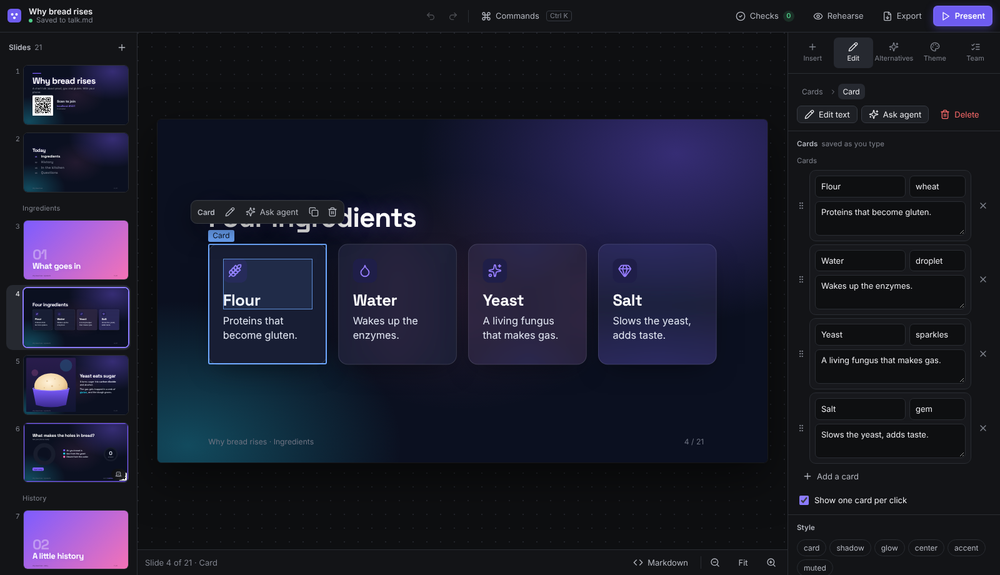
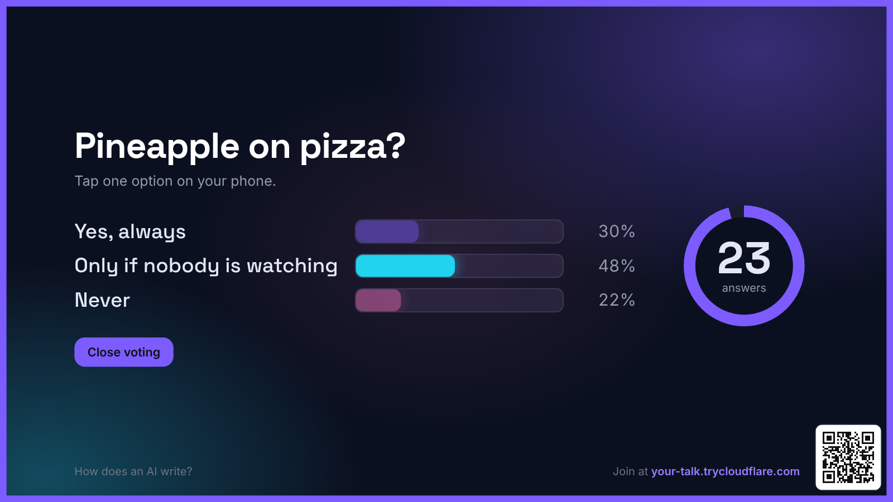
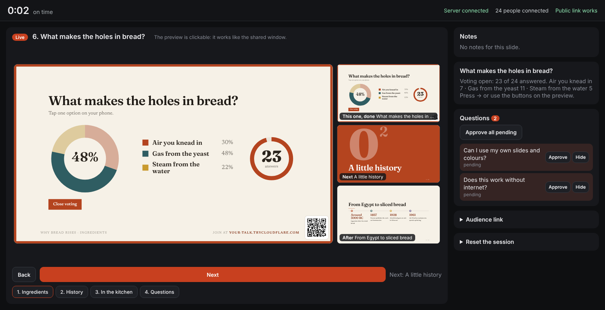
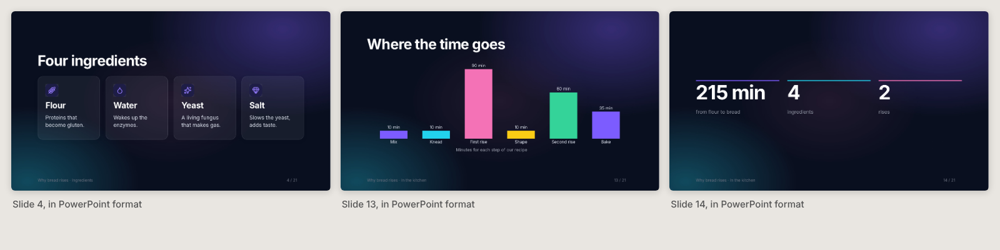

# Quorum

**Your agent writes the talk. You shape it. The room takes part.**

Start from a template, ask Claude Code or any coding agent for the talk you want, then fix and polish it in Studio. Give it live, with polls, quizzes and questions on everyone's phone, or export it to PowerPoint. Everything runs from your laptop: no accounts, no cloud service, no app for the audience.



**[See how it works](https://jboixcampos.github.io/quorum/)**, play the **[showcase talk](https://jboixcampos.github.io/quorum/showcase/)** with a simulated audience, or write a slide in the **[playground](https://jboixcampos.github.io/quorum/playground/)**.

## How it works

| | Who | What happens |
| --- | --- | --- |
| **1. Start** | you | `npx github:JBoixCampos/quorum new my-talk`. You get `talk.md` (a finished sample talk, "Why bread rises", to change or start over from), instructions for agents and checks on every push |
| **2. Write** | your agent | Claude Code, Codex, Cursor or an agent in the cloud writes the slides, runs `quorum check` and fixes what it finds |
| **3. Shape** | you, in Studio | Type on the slide, drag in polls and charts, try other layouts, ask your agent for alternatives |
| **4. Give** | you, in Studio | **Present** opens a link and QR code for the room, the slides and your panel. **Export** writes an editable PowerPoint file |

```bash
npx github:JBoixCampos/quorum new my-talk
cd my-talk
npm install
npm run studio
```

You need [Node.js](https://nodejs.org) 18 or newer. The talk is plain Markdown in a git repository: your agent and Studio edit the same files, each sees the other's changes as they are saved, and `git diff` always shows what changed.

## A poll is a slide

```markdown
::: poll {#lunch} Where should we go for lunch?
- Tacos
- Ramen
- [x] The place with the long queue

The queue is long for a reason.
:::
```

That is a whole slide: the format your agent writes, and the block Studio's poll form edits. Press → to open voting, → to close it and show the results, → to reveal the answer.

| Block | What the audience does | On screen |
| --- | --- | --- |
| `::: poll` | Pick one option, or the right one in a quiz | Live bars, a donut, a race... and the answer when you reveal it |
| `::: multi` | Pick several | Live bars |
| `::: estimate` | Guess a number | Every guess as a dot, the average, then the real answer |
| `::: rounds` | The same question over a list | One result per round |
| `::: sentence` | Write a sentence one word at a time | The sentence growing, like a language model |
| `::: questions` | Ask and upvote, anonymously | Approved questions, most voted first |
| `::: component` | Whatever you build | Whatever you build |

Plus everything a talk needs to look designed: eight themes, layouts (split with a picture, full bleed, section dividers, statements, quotes, big numbers, a free canvas), cards, timelines, steps, key figures, charts from your numbers, icons, highlighted code, transitions and speaker notes. See [Design and themes](docs/design.md).

## Studio

`npm run studio` (or just `quorum` in a talk folder) opens the editor:

- **Edit**: double click to type on the slide, drag blocks and cards to move them, drop pictures from your desktop, style with one click, place things freely on a canvas slide.
- **Insert**: polls, quizzes, guesses, questions, charts, cards, steps and pictures, to click or drag onto a slide or between slides. Interactive blocks have a form: the options of a poll, the right answer, the numbers of a chart.
- **Alternatives**: the slide laid out other ways by Quorum, instantly, and versions written by your agent when you ask for them.
- **Ask your agent**: Quorum has no AI of its own. Studio writes the request (which slide, which lines, what you want) for you to paste into your agent, and shows the result when it is saved.
- **Checks, rehearse, present, export**, from the top bar.

See [Studio](docs/studio.md).

## Present it live

| What the room sees | What you see | What each phone sees |
| --- | --- | --- |
|  |  |  |
| The presentation window, shared or projected. Results land as they arrive. | Your panel: a clickable preview, the next slides, notes, the clock and questions to approve. | Only the question of the moment, after scanning the QR code. |

**Present** in Studio starts a small server on your laptop, opens a public link with [cloudflared](https://developers.cloudflare.com/cloudflare-one/connections/connect-networks/downloads/) (or ngrok) if you have it, or uses your local network, puts the QR code on your slides and opens the two windows. See [Presenting](docs/giving-a-talk.md).

## Or export it to PowerPoint

**Export** writes an editable `.pptx`: real text, shapes, tables and charts (with their data), your notes, transitions and click steps. Slides where the audience answers become a panel that points to Quorum, or, after the talk, a chart of what the room answered. So Quorum is also how an agent makes a PowerPoint deck, with nobody voting at all. See [PowerPoint and PDF](docs/powerpoint.md).



## Teams and agents in the cloud

A talk is a git repository, so teams work the way programmers do: branches and pull requests. One file per slide (`quorum split`) and a merge driver that merges slide by slide keep parallel work from colliding; every push runs the checks and keeps a playable copy and a PowerPoint file; `quorum diff main --pictures` shows what a branch changed, before and after. See [Teams and repositories](docs/repository.md).

## Build on it

A component is one JavaScript file next to your talk. Add `audience:` to its block and phones get a text box, a number field or a list of options; your component receives the answers and draws them however it likes.

```markdown
::: component word-cloud
audience: text
prompt: One word: how do you feel about AI?
:::
```

```js
// components/word-cloud.js
export default {
  mount(el, ctx) {
    const paint = (c) => {
      el.textContent = (c.answers.values || []).join(' · ');
    };
    paint(ctx);
    return { update: paint };
  },
};
```

Quorum takes care of the rest: opening and closing, the QR code, one answer per phone, simulated answers in the preview, and keeping the shared window and your panel in sync.

The [examples](https://jboixcampos.github.io/quorum/examples/) include a word cloud and a **next-word explorer** that asks a language model running on your laptop (through [llama.cpp](https://github.com/ggml-org/llama.cpp)) for the ten most likely next words, so the audience can watch a model think and steer it. See [docs/components.md](docs/components.md).

## For agents

- Every talk has an **[`AGENTS.md`](templates/starter/AGENTS.md)** (and a `CLAUDE.md` that points to it): the format, how to check, how to write a component, how to hand back alternatives, and what never to touch.
- **`quorum check --json`** prints `{ ok, title, slides, theme, interactions, warnings, issues, suggestions }` and exits non-zero while there are warnings. With `--visual` it measures every slide in a browser.
- **`quorum schema --json`** lists every theme, setting, layout, block, class, chart and icon, so the agent never guesses a name.
- **`quorum snapshot`** saves a picture of every slide, for agents that can look at images.
- **`quorum variant add <slide>`** saves a version of a slide for the person to choose in Studio.
- **`quorum skill`** installs the skill in [agents/quorum/](agents/quorum/SKILL.md) for Claude Code, with a library of [slide patterns](agents/quorum/patterns.md).
- **[llms.txt](https://jboixcampos.github.io/quorum/llms.txt)** and **[llms-full.txt](https://jboixcampos.github.io/quorum/llms-full.txt)**: the docs as an index and as one file.

See [Working with an agent](docs/agents.md).

## Commands

Studio does most of this; the commands are there for agents, CI and terminals. `quorum help` lists them all.

```
For you
  quorum                     Open Studio (in a talk folder)
  quorum new <folder>        Start a talk: talk.md, AGENTS.md, package.json, CI (--repo: git too)
  quorum studio [folder]     Edit, rehearse, present and export
  quorum present [folder]    Give the talk live: public link, QR code, windows
  quorum preview [folder]    The talk with a simulated audience
  quorum export --pptx       A PowerPoint file (--pdf, --results, --no-audience, --safe-fonts)

For agents and CI
  quorum check [--json] [--visual]   Mistakes, contrast, slides that do not fit
  quorum snapshot             A picture of every slide, and a contact sheet
  quorum schema [--json]      Every theme, layout, block, class and icon
  quorum remix <slide>        Other layouts for a slide (--pick <n> applies one)
  quorum variant add <slide>  Save a version of a slide for the person to choose
  quorum diff [rev]           Which slides changed since a branch, tag or commit (--pictures)
  quorum split / join         One file per slide in slides/, and back
  quorum repo                 Slide by slide merging in this clone, and the CI workflow
  quorum build                A static, playable copy of the talk
```

## Documentation

Read it on the website, [jboixcampos.github.io/quorum/docs](https://jboixcampos.github.io/quorum/docs/), or here:

- [Get started](docs/README.md): the workflow in four steps
- [Working with an agent](docs/agents.md): what to ask, how it checks its work, agents in the cloud
- [Studio](docs/studio.md): editing, inserting, forms, alternatives, presenting and exporting
- [Alternatives for a slide](docs/remix.md): Quorum's own layouts and versions from your agent
- [Presenting](docs/giving-a-talk.md): the day itself, on stage or on a call
- [PowerPoint and PDF](docs/powerpoint.md): the export, and decks made by agents
- [Teams and repositories](docs/repository.md): branches, one file per slide, merging, checks on every push
- Reference: [the talk format](docs/format.md), [design and themes](docs/design.md), [components](docs/components.md)

## Under the hood

Presenting runs a small Node server on your laptop (no dependencies) and a tunnel gives it a public address. Phones talk to it with plain HTTP long polling, which goes through tunnels, corporate proxies and conference wifi better than WebSockets. The same session code runs on the server and in the browser, which is how the preview and static builds work without a server.

The audience is anonymous: each phone gets a random id kept in its browser. Phones never see your notes or the right answers before you reveal them. Votes and questions are stored in `.quorum/` inside your talk folder, on your laptop, and `quorum clean` deletes them. The presenter key in that folder is what lets you control the talk: never share it.

## Development

```bash
npm test               # unit tests
npm run test:e2e       # a live talk with phones, the website, the PowerPoint export and Studio, in a headless browser (needs Playwright)
npm run demo           # preview the example talk
npm run build:site     # the website in _site/, with every internal link checked
```

The website is built from this repository: `site/index.html` is the landing page, `docs/*.md` become the docs pages, `examples/components/*.js` the examples gallery, and `examples/showcase` the playable showcase that also renders the playground. Look at it with `python3 -m http.server -d _site`. [AGENTS.md](AGENTS.md) describes the project layout and conventions.

## License

MIT. Quorum includes fonts under the SIL Open Font License 1.1 (see `app/fonts/FONTS.md`), icons from [Lucide](https://lucide.dev) (ISC) and a QR code generator by Kazuhiko Arase (MIT). See [LICENSE](LICENSE).
