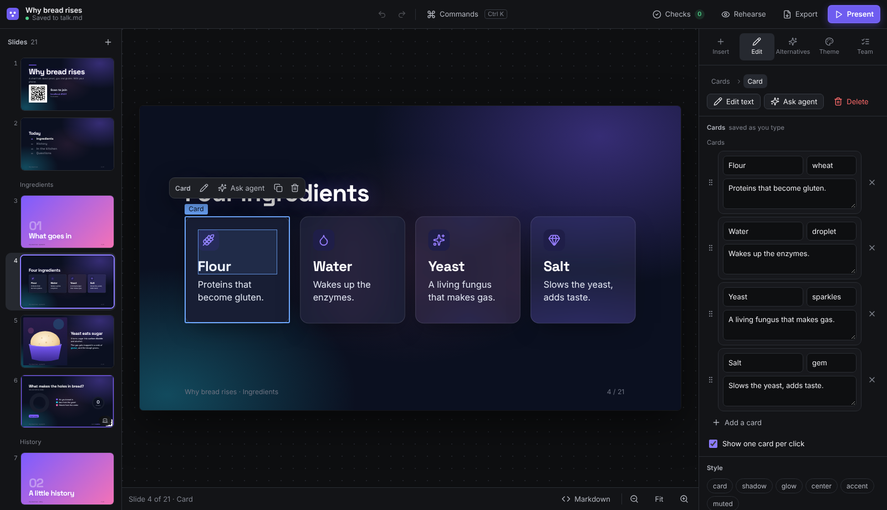

# Get started

Quorum lets you make a talk with your AI coding agent, then present it so the audience can answer from their phones. It is free and open source, and it runs on your laptop.

## Your first talk

You need [Node.js](https://nodejs.org) 18 or newer and a coding agent, such as Claude Code, Codex or Cursor.

### 1. Make a talk folder

```bash
npx github:JBoixCampos/quorum new my-talk
cd my-talk
npm install
```

Prefer GitHub? Use the [quorum-talk template](https://github.com/JBoixCampos/quorum-talk/generate) instead. You get the same folder, as a repository of your own.

### 2. Ask your agent for the talk

Open your agent in the `my-talk` folder and describe the talk you want, the way you would ask a colleague:

```text
Make me a 15-minute talk on why bread rises, for curious non-bakers.
Start with a poll, add a quiz on yeast and end with a questions slide.
```

That is all it needs. The folder already explains Quorum to the agent, and the agent checks its own slides and fixes what does not fit. See [Ask your agent](agents.md) for more ideas on what to ask.

### 3. Tweak it and present

```bash
npm run studio
```

Studio opens in your browser with the real slides.



- **Change something small**: click on the slide and type, or drag a poll or a chart in from **Insert**.
- **Change something big**: select it and press **Ask agent**. Then tell your agent "do the open Quorum requests".
- **Practise**: **Rehearse** plays the talk with 24 pretend people who vote and ask questions.
- **Give the talk**: **Present** puts a QR code on your slides. People scan it and answer from their phones.
- **No audience?** **Export** writes a PowerPoint file or a PDF.

## Try a slide

This is what your agent writes. Click the slide to open the vote, then again to close it and to reveal the answer.

<!-- showcase-slide: 6 -->

## Next

- [Ask your agent](agents.md): what to ask for, and how the agent checks its work.
- [Edit in Studio](studio.md): everything you can do in the editor.
- [Present on the day](giving-a-talk.md): the screens, the phones, and what to do if people cannot join.
- [Work as a team](teamwork.md): colleagues and several agents on the same talk.
- [PowerPoint and PDF](powerpoint.md): exporting, and making decks with an agent.
- Reference: [the talk format](format.md), [design and themes](design.md), [components](components.md), [alternatives for a slide](remix.md), [git and repositories](repository.md).

## Commands

Studio does most of this. The commands are there for agents, CI and people who prefer a terminal.

| Command | Does |
| --- | --- |
| `quorum` | Open Studio, in a talk folder |
| `quorum new <folder>` | Start a talk (`--repo` also starts git) |
| `quorum studio [folder]` | Edit, rehearse, present and export |
| `quorum present [folder]` | Give the talk live: public link, QR code, windows |
| `quorum preview [folder]` | The talk with a simulated audience |
| `quorum check [folder]` | Mistakes and design problems (`--json` for tools, `--visual` to measure in a browser) |
| `quorum snapshot [folder]` | A picture of every slide, and a contact sheet |
| `quorum schema` | Every theme, layout, block, class and icon (`--json`, `--icons`) |
| `quorum export --pptx` | A PowerPoint file (`--pdf`, `--results`, `--no-audience`, `--safe-fonts`) |
| `quorum requests` | What you asked for in Studio (`show`, `claim`, `done`, `--watch`) |
| `quorum context <slide>` | What a fresh agent needs to work on a slide |
| `quorum slide get`, `quorum slide set` | Read a slide, or write it only if nobody changed it meanwhile |
| `quorum decide "<text>"` | Add to the talk's decision log |
| `quorum remix <slide>` | Other layouts for a slide (`--pick <n>` applies one) |
| `quorum variant add <slide>` | Save a version of a slide for the person to choose in Studio |
| `quorum diff [rev]` | Which slides changed since a branch, tag or commit (`--pictures`) |
| `quorum split`, `quorum join` | One file per slide, and back |
| `quorum repo` | Slide by slide merging in this clone, and the CI workflow |
| `quorum theme new <name>`, `quorum theme from <logo>` | Save the look as a theme file, or make one from a logo |
| `quorum theme guide <name> --from <file>` | Turn written brand guidelines into a theme and a design guide, with your agent ([how](design.md#from-your-companys-guidelines)) |
| `quorum build [folder]` | A static, playable copy of the talk |
| `quorum export [folder]` | The slides without the audience parts, as a website |
| `quorum clean [folder]` | Delete the votes and questions of the last session |
| `quorum skill` | Install the agent skill for Claude Code (`--to <folder>` for other agents) |

`quorum help` lists the options.
