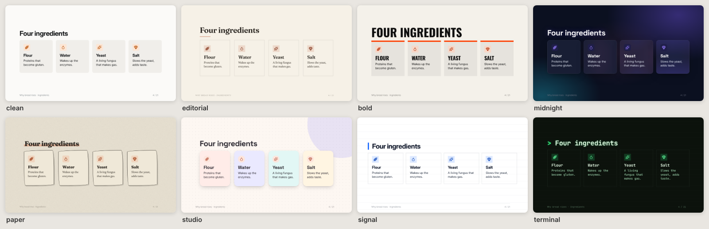

# Design and themes

A talk that looks good keeps people watching. Quorum gives you the pieces to make it look good in plain Markdown: a theme in one line, layouts that change how a slide is composed, visual blocks, charts, icons and motion. Every option is a fixed name that `quorum check` validates, so an agent can use all of it without writing CSS.



## A theme in one line

```yaml
---
title: Why bread rises
theme: midnight
---
```

| Theme | Feel | Good for |
| --- | --- | --- |
| `clean` | Neutral, light, one orange accent (the default) | Anything |
| `editorial` | Serif titles, warm paper, thin rules, generous margins | Lectures, research, books |
| `bold` | Huge condensed capitals, solid colour blocks | Keynotes, launches |
| `midnight` | Dark, soft gradients, glowing accents, glass cards | Keynotes, product talks |
| `paper` | Grain, handwritten notes, marker highlights | Workshops, storytelling |
| `studio` | Rounded cards, soft shadows, bright colours | Classrooms, workshops |
| `signal` | Strict grid, white, one strong blue | Company meetings, pitches |
| `terminal` | Monospace, green on black, scanlines | Technical talks, demos |

`theme: light` and `theme: dark` still work: they are `clean` in light or dark. Any other setting in the front matter wins over the theme, so `theme: signal` with `accent: "#e30613"` is the signal look in your red. `mode: light` or `mode: dark` switches a theme to the other mode.

Phones follow the theme too: its colours, fonts, corners, texture, and one colour per answer.

## Fine tuning

Each of these takes one of a few values. A theme sets all of them; set any of them yourself to change just that.

| Setting | Values | What it changes |
| --- | --- | --- |
| `scale` | compact, normal, large, huge | The size of all text |
| `weight` | light, regular, bold, heavy | How heavy titles are |
| `case` | none, upper, small-caps | Titles in capitals or small capitals |
| `radius` | none, soft, round, pill | Corners of cards, images, bars, buttons |
| `density` | tight, normal, airy | Margins and gaps |
| `surface` | flat, outline, shadow, glass | How cards, callouts and bars are drawn |
| `texture` | none, grain, dots, grid, lines | A subtle pattern on the background |
| `gradient` | none, aurora, sunset, ocean, mesh, spotlight | A gradient over the background |
| `transition` | none, fade, slide, zoom, morph | How one slide replaces the previous one |
| `charts` | bars, columns, donut, pictogram, race, bubbles | How poll results are drawn |
| `reveal` | highlight, flip, spotlight | How the right answer appears |

Colours and fonts:

```yaml
accent: "#0b5fff"                      # buttons, bars, the frame around audience slides
primary: "#101820"                     # titles
secondary: "#00a078"                   # list markers, subheadings, callout titles
background: "#f7f4ee"
text: "#1d1d1b"
palette: ["#0b5fff", "#00a078", "#f59e0b", "#e11d48"]   # one colour per answer and per chart bar
font: fonts/Brand-Bold.woff2           # titles: a font file or a CSS font-family
text-font: Georgia, serif              # body text
accent-font: Caveat, cursive           # *emphasis* and the .hand class
```

Without a `palette`, a theme brings its own; without either, bars use the accent and charts that need several colours make them from it.

## Your theme, in a file

A company can keep its look in one file and use it in every talk:

```yaml
theme: themes/acme.yaml
```

```yaml
# themes/acme.yaml
extends: signal
accent: "#0b5fff"
logo: ../images/logo.svg     # paths are relative to this file
font: ../fonts/AcmeSans-Bold.woff2
footer: Acme · {section} | {n} / {total}
```

Two commands help:

```bash
quorum theme new acme            # save this talk's look as themes/acme.yaml
quorum theme from logo.svg       # propose colours and a theme from a logo (SVG or PNG)
```

`quorum theme from` prints the front matter lines to paste; `--save acme` also writes the theme file.

## Layouts

A layout changes how the slide is composed. Put it at the top of the slide.

```markdown
<!-- layout: split -->

## Yeast eats sugar


It turns sugar into gas, and the gluten traps it.
```

| Layout | What it does |
| --- | --- |
| `title` | An opening slide: a large title, a subtitle |
| `section` | A divider in the accent colour, with the section number |
| `agenda` | The talk's sections (from `<!-- section: -->`), the next one highlighted |
| `split` | The first image or video on one half, edge to edge. `split, right` puts it on the right |
| `full` | The first image fills the slide; the text sits on a panel. `full, right` or `full, center` move the panel |
| `statement` | One sentence, very large |
| `quote` | A `>` quotation, its author in the next paragraph |
| `big-number` | The first heading becomes one huge figure |
| `grid` | Images or cards in an even grid under the title |
| `compare` | Columns with a divider between them |
| `center` | Everything centred |
| `closing` | The last slide |

Other slide settings:

```markdown
<!-- transition: zoom -->          how this slide comes in
<!-- background: aurora -->        a gradient, a colour or an image behind this slide
```

## Classes and attributes

Curly braces after a heading, a paragraph, an image or a block opener change that one element.

```markdown
## The three stages {.center .accent}

A quieter line. {.muted}

{.round width=300}
```

| Class | Effect |
| --- | --- |
| `.center`, `.left`, `.right` | Alignment. Images with `.left` or `.right` float beside the text |
| `.accent`, `.secondary`, `.muted` | Colour |
| `.huge`, `.big`, `.small` | Size |
| `.hand`, `.upper` | The accent font, capitals |
| `.card`, `.shadow`, `.glow` | A card behind it, a shadow, a glow |
| `.outline`, `.gradient` | Titles as an outline, or filled with the palette |
| `.cover`, `.contain`, `.round`, `.bleed` | Images: fill, fit, circle, to the slide's edges |
| `.steps` | Blocks: one item per click |
| `.vertical` | Timelines: top to bottom |
| `.controls` | Videos: play controls instead of playing on their own |

Attributes: `icon=name` (headings), `width=` and `height=` (images), `color=accent` (headings, paragraphs), `chart=` and `reveal=` (interactions), `lines=` (code), and the settings of each block below. `{#name}` gives an element a name, which the `morph` transition uses.

Anything Quorum does not know is a warning in `quorum check`, with the list of what it knows. Ordinary text in braces, like `{name}`, stays text.

## Visual blocks

### Cards

Columns as cards, separated by `+++`. A heading with `{icon=name}` puts an icon on top.

```markdown
::: cards {.steps}
### Flour {icon=wheat}
Proteins that become gluten.

+++

### Yeast {icon=sparkles}
A living fungus that makes gas.
:::
```

### Timeline

```markdown
::: timeline {.steps}
- 1857: Pasteur publishes his work on fermentation
- 1928: sliced bread goes on sale
- 1961: the Chorleywood process
:::
```

### Steps of a process

```markdown
::: steps
- Mix: flour, water, yeast, salt
- Knead: ten minutes
- Bake: hot oven
:::
```

### Key figures

Numbers count up when they appear.

```markdown
::: kpis
- 215 min: from flour to bread
- 4: ingredients
:::
```

### Compare

```markdown
::: compare {vs="or"}
### Fresh
Crisp crust.

+++

### Sliced
Lasts longer.
:::
```

### Charts

A chart from `label: number` lines, in the theme's colours: `bar`, `column`, `line`, `donut` or `pictogram`.

```markdown
::: chart column {unit=min title="Minutes for each step of our recipe"}
Mix: 10
Knead: 10
First rise: 90
Bake: 35
:::
```

Options: `title=`, `unit=`, `max=` (the top of the scale), and for pictograms `icon=` and `per=` (how much one icon is worth).

### Icons, badges and highlights

```markdown
Ready in an hour :icon[clock] :badge[new] and ==highlighted like a marker==.
```

There are about 230 icons, from [Lucide](https://lucide.dev); `quorum schema --icons` lists them. A few short names work too: `idea`, `team`, `money`, `growth`, `ai`.

### Code

Code blocks are highlighted (JavaScript, TypeScript, Python, shell, JSON, HTML, CSS, SQL, Go, Rust, Java, C, Ruby, PHP and similar). `{lines=}` highlights lines, one range per click:

~~~markdown
```js {lines=1-2|4-6}
const start = Date.now();
const doubled = (v) => v >= 2 * startVolume;

while (!doubled(volume())) {
  await wait(minutes(10));
}
```
~~~

### Videos

A video file in image syntax plays on its own, muted and looping: ``. Add `{.controls}` for play controls.

## Motion

- **Transitions**: `transition:` in the front matter for the whole talk, or `<!-- transition: -->` on one slide: `fade`, `slide`, `zoom`, `morph` or `none`.
- **Morph**: with `transition: morph`, elements with the same `{#name}` on two slides move and resize from one to the other. Give the title of several slides the same name and it glides between them.
- **Step effects**: two dashes reveal the next step; add an effect after them: `-- fly`, `-- zoom`, `-- blur`, `-- drop` or `-- highlight`.
- **Results** grow with a spring, numbers count up, and the right answer gets a short emphasis.

All of it turns off when the computer asks for less motion, and in thumbnails and exports.

## Results

Every poll, multi and rounds slide can draw its results in a different way, with `chart=` on the block or `charts:` in the front matter:

| Kind | Looks |
| --- | --- |
| poll, multi, rounds | `bars`, `columns`, `donut`, `pictogram`, `race` (bars re-sort as votes come in), `bubbles` |
| estimate | `strip` (every guess as a dot), `histogram`, `beeswarm`, `thermometer` |
| sentence | `bars`, `tree` (the words not chosen stay visible) |
| questions | `list`, `wall` (cards), `spotlight` (one question at a time, large) |

`reveal=` chooses how the right answer appears: `highlight`, `flip` or `spotlight` (everything else fades).

```markdown
::: poll {#holes chart=donut reveal=spotlight} What makes the holes in bread?
- Air you knead in
- [x] Gas from the yeast
- Steam from the water
:::
```

## Phones

```yaml
phone-welcome: Welcome! *Bread questions* are coming.
phone-thanks: Thanks for baking with us.
phone-background: images/flour.jpg      # or a colour
reactions: 👏 🤯 🍞 ❤️
```

`reactions:` puts up to six emoji at the bottom of every phone. Anyone can tap one at any time and it floats up on the screen. Reactions are counted, never linked to who sent them.

## Anything else

**CSS for one slide.** A `::: style` block applies only to its slide. Rules apply inside the slide; bare declarations apply to the slide itself.

```markdown
::: style
background: linear-gradient(120deg, #0b5fff, #00a078);
h2 { color: white; }
:::
```

**CSS for the whole talk.** `style: brand.css` in the front matter, loaded last. Slides are `.q-slide` (with `layout-<name>`), their content `.q-content`, the logo `.q-logo`, the footer `.q-footer`. The theme's values are CSS variables: `--accent`, `--primary`, `--secondary`, `--bg`, `--fg`, `--series-1` to `--series-8`, `--radius`, `--font-display`, `--font-text`, `--font-accent`.

**Components** get the theme too: see [ctx.theme and ctx.ui](components.md#looking-like-the-talk).

## Check how it looks

`quorum check` also looks at the design:

- **Warnings** (the check fails): text or titles with too little contrast against the background, and, with `--visual`, slides whose content does not fit.
- **Suggestions** (the check passes): slides with too many words or list items, images without a description, four or more plain text slides in a row, and slides that may not fit.

```bash
quorum check --json            # adds "issues" and "suggestions", each with a kind and a slide
quorum check --visual          # measures every slide in a browser, results included
quorum snapshot                # a picture of every slide, and contact.png with all of them
```

`--visual` and `snapshot` need Playwright (`npm install --no-save playwright && npx playwright install chromium`). Pictures go to `.quorum-snapshots/`, which is never published with the talk.

`quorum schema` lists every theme, setting, layout, block, class and look (`--json` for tools, `--icons` for the icon names). See [Built for agents](agents.md) for how an agent uses all of this.
