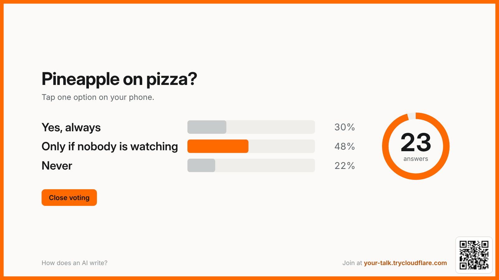
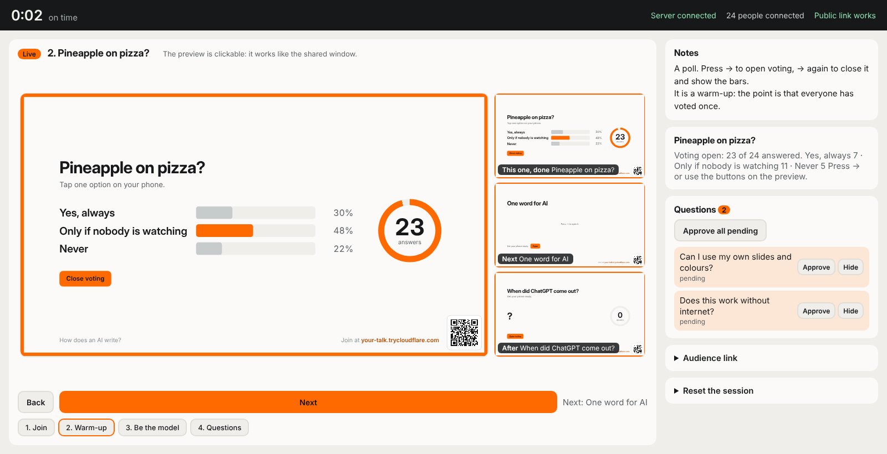
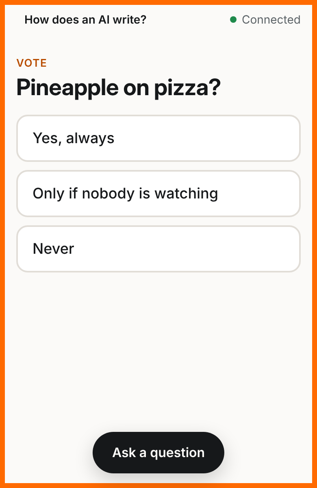

# Giving a talk

## Before the day

1. **Go through it with the preview.** `quorum preview my-talk` shows the talk with 24 simulated people who join, vote and ask questions, so every slide looks the way it will with a room. Click through it once with a clock: votes take longer than you think (count on 30 to 60 seconds each).
2. **Run `quorum check my-talk`.** It lists anything that looks wrong in `talk.md`.
3. **Install cloudflared** for the public link: `winget install --id Cloudflare.cloudflared` on Windows, `brew install cloudflared` on a Mac, or see [Cloudflare's downloads](https://developers.cloudflare.com/cloudflare-one/connections/connect-networks/downloads/). ngrok works too. Without either, only people on the same network as your laptop can join.
4. **Do a test run with a real phone**, on mobile data rather than your wifi: `quorum live my-talk`, scan the QR code, vote once, then `quorum clean my-talk`.
5. If you will be **on a video call**, try sharing the presentation window with the tool you will use.

## On the day

```bash
quorum live my-talk
```

It opens two windows on your laptop and prints the audience link, the one in the QR code. That gives three views of the same talk, always in sync.

### What the room sees: the presentation

It opens in its own window. Share or project this window, and only this one. The QR code stays in the corner whenever the audience can answer, so latecomers can still join.



### What you see: the panel

It opens in your browser and is only for you: a clickable preview of the presentation, the next slides, your notes, the clock against your plan, how many people are in, the votes so far, and the questions waiting for your approval. Never share it: its link contains the presenter key.



### What each phone sees

After scanning the QR code, a phone shows only what the room is asked right now, and a button to ask a question. No app, no account, no name.



### Driving the talk

Drive the talk from either window. In the panel, click the preview or use the arrow keys; in the presentation, use the keyboard or a clicker.

| Key | Does |
| --- | --- |
| → Space Page Down Enter | Next: open voting, close it, reveal, then the next slide |
| ← Page Up Backspace | Previous |
| Home / End | First / last slide |
| N | Speaker notes on the presentation (only if you are not sharing it) |
| F | Full screen |

Clicking the right part of the presentation also moves forward; clicking the left third goes back.

### With one screen

On a call with one monitor, share the presentation window and keep the panel in another window or on a tablet (open the panel link there). The presentation window is opened with settings that keep it painting while other windows cover it, so the call keeps showing it live.

### Questions

People can ask at any time from the button on their phone. New questions wait in the panel until you approve them (or approve all). On the questions slide, click one to highlight it while you answer, and click again to mark it as answered.

## If people cannot join

- **The public link stops**: the terminal says so, and the QR code switches to your laptop's address on the local network, so people on the same wifi can still join. For a new public link, press Ctrl+C and run `quorum live my-talk` again. Votes and questions are kept.
- **No internet, but one network**: `quorum live my-talk --no-tunnel`, and everyone joins on the same wifi as your laptop.
- **Nobody can join at all**: give the talk without the audience. `quorum export my-talk` makes a copy with only the slides nobody answers (the QR code is left out too), in `my-talk/export`. Present it from any static web server, for example `python3 -m http.server -d my-talk/export`, and open the address it prints. Make one before the day, just in case.

## After the talk

- The results stay in `my-talk/.quorum/state.json` until you delete them. Copy what you need (the panel shows every question), then run `quorum clean my-talk`.
- `quorum clean my-talk --key` also creates a new presenter key next time.
- To share a playable version of the talk afterwards, `quorum build my-talk` makes a static site that anyone can open and click through with a simulated audience. It contains your slides and components, never the votes or questions.

## Privacy

- People join without an account or a name. Each phone gets a random id stored in its browser, used only to count one vote per phone.
- Votes and questions live in your talk folder, on your laptop. Nothing is sent to any other service except through the tunnel you start.
- Questions are limited to 140 characters, and to one every few seconds per phone.
- The presenter key (in `.quorum/key.txt` and in the presentation and panel links) is what controls the talk. Do not show those links on screen or share them.
