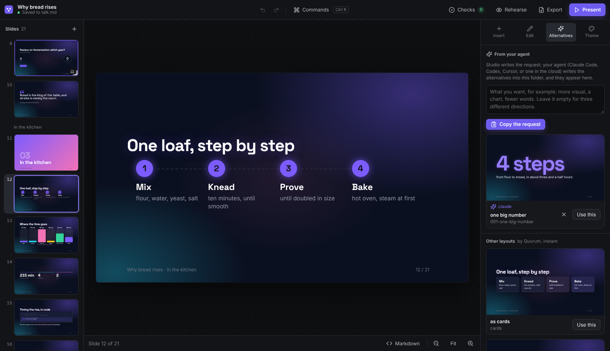

# Alternatives for a slide

Unsure about a slide? Look at it laid out other ways and choose one. The alternatives come from two places:

- **Quorum's own layouts**: instant, and they need no AI. Quorum knows its blocks, so it rewrites the same content as cards, steps, a timeline, a chart, a split with a picture, a statement and more.
- **Your agent**: for anything Quorum cannot do on its own (new wording, a different angle, a picture), Studio writes a request for your agent, and the versions it saves appear next to Quorum's.

## In Studio

Select a slide and open the **Alternatives** tab.



**Use this** replaces the slide with that version; undo brings the old one back. Every option is drawn in your theme, so what you see is what you get.

To ask your agent, write what you want in the box ("more visual", "a chart", "fewer words", or nothing for three different directions) and press **Copy the request**. Paste it into your agent. It writes each alternative as a file in `variants/<slide>/`; Studio shows them as they arrive, marked with the name of the agent that made them. Dismiss the ones you do not want.

## From the command line

The same for agents and for people who prefer a terminal:

```bash
quorum remix four-ingredients      # a picture of the options, numbered
quorum remix four-ingredients --pick 3
```

The slide is a slide id (`quorum check` and `quorum diff` show them) or its number. The picture, saved in `.quorum-snapshots/explore/<slide>/options.png`, shows the slide as it is (1) and each alternative in your talk's own theme:

```text
One loaf, step by step: 5 other layouts

  1  current          the slide as it is
  2  cards            as cards
  3  timeline         as a timeline
  4  list             as a plain list
  5  cards-reveal     as cards that appear one by one
  6  centered         everything centred

Look at them: .quorum-snapshots/explore/one-loaf-step-by-step/options.png
Choose one: quorum remix one-loaf-step-by-step --pick <number>
```

`--pick 3` (or `--pick cards`) writes that version into the slide and leaves everything else alone. Drawing the picture needs [Playwright](https://playwright.dev); picking does not.

There are no scores. The only thing marked is a real problem: a layout that does not fit the slide, or that the checks complain about. Which one looks best is for you to say.

## What Quorum can rearrange

Quorum knows its own blocks, so it reads what the slide holds and writes the same content in the structures that fit:

| The slide has | Quorum offers |
| --- | --- |
| A list of two to six short items | cards, the steps of a process, a timeline (when the items have dates or short labels), one item per click, a plain list |
| Items that start with a number (`215 min: ...`) | key figures |
| Items with a number (`Tacos: 56`, `Mix: 10 min`) | bar, column and donut charts |
| A chart | another chart type (bar, column, donut, line), key figures, cards |
| Cards, steps or a timeline | any of the other forms, or a plain list |
| A table of numbers | a chart or key figures |
| Two headings with content under each | a comparison, or two cards |
| A picture and some words | the picture on the left, on the right, or filling the slide |
| One strong sentence | a statement, a big number (`87 keys on a piano`), a quotation |
| Any slide | everything centred |

Notes (`::: notes`), sections, ids and other settings on the slide are kept. Slides where the audience answers (polls, estimates, components that ask) are left alone: remix the slides around them.

## Variants from agents

Quorum's remixes are the baseline. For real alternatives, ask an agent for several, each with a different direction ("data first", "one image and one sentence", "playful", "minimal"). An agent that can start sub-agents can write them side by side. Each one saves a file:

```bash
quorum variant add four-ingredients --by claude --direction "data first" < slide.md
quorum variant list four-ingredients
```

Variants are plain files in `variants/four-ingredients/`, with a first line saying who made them and what they try:

```markdown
<!-- variant: by=claude; direction=data first -->

## Four ingredients

::: kpis
- 4: ingredients
- 2: rises
:::
```

Because they are files, an agent can commit them to a branch and push: you pull, run `quorum remix four-ingredients`, and the picture shows the slide, the agents' variants and Quorum's own remixes together, numbered in that order. Pick one with `--pick`, which uses it and removes its file.

```bash
quorum variant remix four-ingredients   # save Quorum's own remixes as variant files too
quorum variant pick four-ingredients 002-data-first
quorum variant clear four-ingredients
quorum remix four-ingredients --no-remix   # only the variants in variants/
```

A slide keeps its variants as long as its id stays the same, and an id comes from its title. Give a slide an id (`<!-- id: ingredients -->`) before asking for variants if its title may change.

A variant is one slide: it cannot contain a line that is only `---`. `quorum variant add` refuses it if it does.

## Trying themes

Before polishing slides, pick a direction for the whole talk:

```bash
quorum explore --themes editorial,bold,paper
```

It draws the talk's first slides in each theme (four by default, `--count 6` for more) on one picture, with the number of warnings each theme leaves. Your own colours, logo and fonts stay. Use one with `theme: paper` in the front matter.
