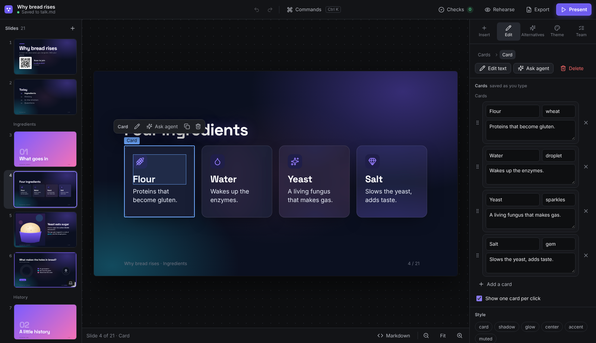
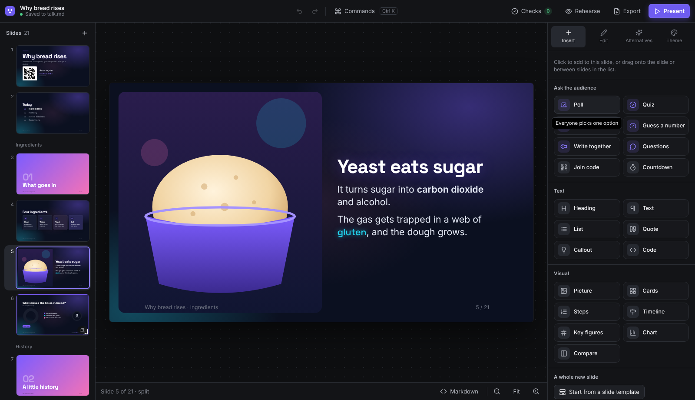
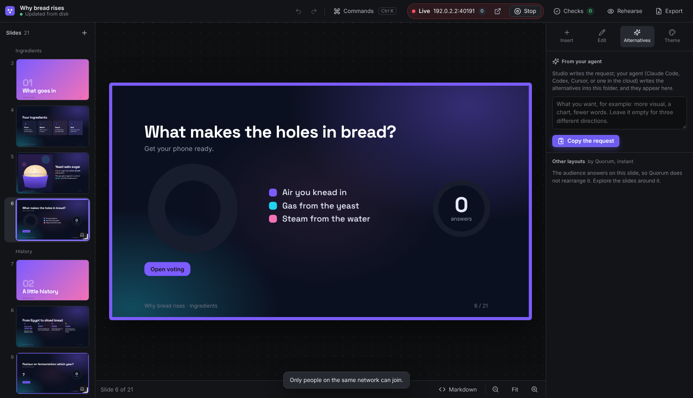

# Edit in Studio

Studio is where you shape a talk once your agent has written it, and where you give it or export it. It runs on your computer and edits the talk's own files: every change you make is a line in `talk.md` that `git diff` shows, and every change your agent makes appears in Studio as soon as it is saved.

```bash
npm run studio        # in a talk folder made from the template or with quorum new
quorum studio my-talk # with a global quorum
quorum                # in a talk folder: the same
```

It opens `http://localhost:8080/studio?key=...` in your browser. The page only answers this computer, and its address holds a key: do not share it.



## The window

| Where | What it is |
| --- | --- |
| Top | Undo and redo, **Commands** (Ctrl+K), the **Checks**, **Rehearse**, **Export** and **Present** |
| Left | Every slide, drawn for real and grouped by section. A mark shows the slides where the audience answers and the ones with something to fix. Drag to reorder; hover to copy or delete |
| Middle | The slide, drawn by the same code that presents it, in your theme. Zoom with the buttons at the bottom; **Markdown** opens the slide's source |
| Right | Four tabs: **Insert**, **Edit**, **Alternatives** and **Theme** |

## Editing

- **Click** something to select it. A toolbar appears above it: edit, ask your agent, duplicate, delete. Shift and click selects the card or group around it.
- **Double click** a title or a paragraph and type, right on the slide. Ctrl+B and Ctrl+I make bold and italics; Enter saves, Esc cancels. Anything more complex (icons, highlights, lists, code) opens its Markdown instead.
- **Drag** to move a block among the blocks of the slide, an item within its list or a card among its cards. A line shows where it will land.
- **Drop pictures** from your desktop onto the slide. They are saved in `images/`; describe them in the Edit tab for people who cannot see them.
- **The Edit tab** shows what you selected: the path to it (`Cards / Card / Text`), a form for the block, its style and, below, the settings of the slide (layout, transition, background, section, notes).

### Forms for blocks

Polls, quizzes and the other interactive blocks are edited with a form, not Markdown:

| Block | The form |
| --- | --- |
| Poll, quiz, several answers | The question, the options (drag to reorder, the tick marks the right one), how results are drawn, how the answer appears, the explanation |
| Guess a number | The question, the answer, the lowest and highest guess, the unit, the scale, the explanation |
| Chart | The type, the data as rows of label and value, the unit, a title |
| Cards, compare | Each card's title, icon and text; one per click |
| Steps, timeline, key figures | The items as rows; one per click |

The form saves as you type. Lines of the block it does not know are kept as they are.

## Inserting



The **Insert** tab holds what you can add, in three groups: what asks the audience (poll, quiz, several answers, guess a number, write together, questions, join code, countdown, QR code, web page), text (heading, text, list, quote, callout, code) and visual blocks (picture, cards, steps, timeline, key figures, chart, compare). Components in your `components/` folder are listed too. Select a countdown, QR code or web page on the slide and its settings appear as a form on the right.

- **Click** one to add it to the end of the slide.
- **Drag** one onto the slide to put it where you drop it, or onto the slide list to make a new slide with it.
- A slide asks the audience one thing at a time, so a second question gets a slide of its own.

**Add slide** (the + above the slides, or Ctrl+K) starts a whole slide from a template: title, section, statement, picture and text, quote, big number, cards, steps, timeline, key figures, chart, compare, poll, questions, closing or canvas.

## Alternatives

The **Alternatives** tab shows the selected slide laid out other ways. Quorum's own layouts are instant (cards, steps, a timeline, a chart, a split with a picture...); for anything more, Studio writes a request for your agent, and the versions it saves appear in the same place. **Use this** replaces the slide; undo brings it back. See [Alternatives for a slide](remix.md).

## Asking your agent

Quorum has no AI of its own. **Ask agent**, on the toolbar of a selection or in the Edit tab, asks what you want ("make this a chart", "shorter", "turn it into a quiz") and saves a request in the talk's `requests/` folder. Studio copies one line for you to give your agent once: it tells the agent to work through the open requests. The details are in the files, so there is nothing long to paste. Studio shows the change as soon as the agent saves it. See [Ask your agent](agents.md).

## The Team tab

The **Team** tab has two parts.

**Requests for your agent** is the queue. Each request shows whether it is open, being worked on (and by whom) or done, with the agent's note when it finishes. A small star on a slide in the list means a request is waiting for it. You can copy the full text of a request for an agent that cannot see your folder, put a stuck one back in the queue, or cancel one.

**Sync with others** is for talks in a git repository. It shows your branch, what you changed but did not send, and what others pushed. Studio looks at the remote once a minute (it only looks; nothing changes on your disk) and marks the slides that changed upstream with a branch icon, so you know before you edit them.

- **Pull** brings in what others pushed, slide by slide. If you and someone else changed the same slide, nothing is merged and Studio says so, so you can ask your agent to resolve it.
- **Send** commits the talk's files (never `.quorum/`) with your message and pushes the branch. It asks you to pull first if others pushed before you.
- **Check now** looks at the remote straight away.

Studio never pulls or pushes on its own. Two people on different computers share a talk through git only: you see each other's work after a push and a pull, not while typing. See [Work as a team](teamwork.md) and [Git and repositories](repository.md).

## Theme

The **Theme** tab sets the look of the whole talk: one of eight themes, light or dark, your colours, the type, shapes and motion, the footer. Each change is a line at the top of `talk.md`. See [Design and themes](design.md).

## Placing things freely

Flowing layouts keep slides readable on any screen, so they are the default. When you want something exactly there, choose the **canvas** layout for the slide. Each element then has a position as a share of the slide:

```markdown
<!-- layout: canvas -->

## Where the gas goes {x=5 y=5 w=60 h=15}

{x=0 y=30 w=55 h=70}

Bubbles grow where the gluten is strongest. {x=60 y=35 w=35 h=20}
```

Drag an element to move it and use its corners to resize it. Edges snap to the slide and to other elements (a pink line shows what lined up); hold Alt to turn snapping off. The arrow keys nudge the selection (Shift for bigger steps). `quorum check` warns about elements that stick out of the slide or overlap.

## Checks

The **Checks** button shows how many things there are to fix: mistakes, colours with too little contrast, slides that may not fit, pictures without a description. Click it for the list, with a button to go to each slide; suggestions to make the talk easier to watch are listed below.

## Rehearse, present, export

- **Rehearse** opens the talk in a new tab with 24 simulated people who join, vote and ask.
- **Present** gives the talk. For a talk with slides that ask the audience, you choose a public link (through cloudflared or ngrok, if installed) or only your local network. Two windows open: the presentation, to share or project, and your panel. Studio shows that the talk is live, the link and how many phones are connected, with a **Stop** button. See [Presenting](giving-a-talk.md).
- **Export** writes a PowerPoint file or a PDF into `export/`, with a progress bar and a summary of what to know (fonts, parts that became pictures). After a talk it can include the results. See [PowerPoint and PDF](powerpoint.md).



## Keys

| Key | What it does |
| --- | --- |
| Ctrl+K | Commands: go to a slide, add a block, change the theme, present, export |
| Ctrl+Z, Ctrl+Shift+Z | Undo, redo |
| Enter | Edit the selected element |
| Delete | Delete the selected element |
| Ctrl+D | Duplicate the selected element |
| Esc | Deselect, or close what is open |
| Page Up, Page Down | Previous and next slide |
| Arrow keys | Nudge the selected element on a canvas slide |

## It is only the files

Studio has no data of its own. Each action is an edit to `talk.md`, or to the file of that slide in a [split talk](repository.md#one-file-per-slide).

- **Undo and redo** remember this session; git is the real history.
- **Changes from outside show up**: your agent, an editor or `git pull` change the files and the slides update on their own. If you edit the same text at that moment, Studio asks before it saves over a change it did not make.
- **Not everything has a form.** Components and anything unusual stay in the Markdown, one click away.

## Safety

Studio can write files and start a live talk, so it is strict about who may ask. It only listens on this computer, needs the key in every request, and refuses requests that name another host or come from another website. It writes only inside the talk's folder (pictures go in `images/`, only picture files up to 15 MB). It never runs code from the talk, and it never runs your agent: your agent reads the requests itself. Sync only runs `git fetch`, `pull`, `commit` and `push` in the talk's folder, when you press the buttons (and `git fetch` once a minute).
