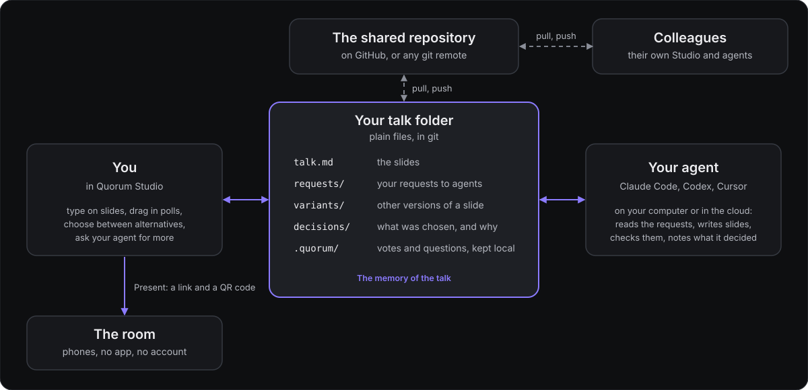
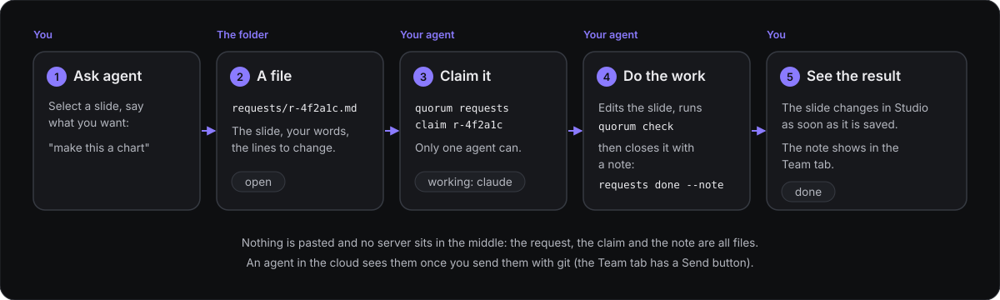
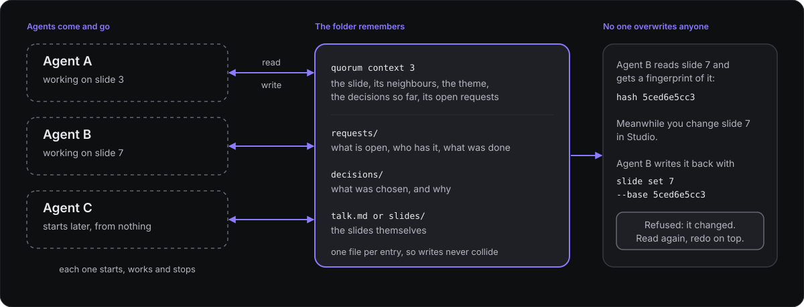

# Work as a team

You can make a talk with colleagues, with several agents, or both. Nobody needs to learn anything new for it.

## The short version

- **Everyone works on the same talk folder.** You in Studio, your agent from its window, colleagues through GitHub.
- **To ask an agent for something**, select it in Studio and press **Ask agent**. Then tell your agent once: "do the open Quorum requests". You do not paste anything else.
- **Nobody's work gets lost.** If two people or agents change the same slide, Quorum notices and asks for the later change to be redone on top, instead of overwriting the first.

The rest of this page explains each part in a little more detail.

## Asking your agent from Studio

1. Select a slide, or something on it, and press **Ask agent**. Say what you want, for example "make this a chart".
2. Studio saves your request in the talk folder and copies a short line for you.
3. Paste that line into your agent once. It works through every open request.
4. The slide changes in Studio as soon as the agent saves it. The **Team** tab shows each request as open, being worked on or done, with a note from the agent.

**If your agent runs in the cloud** (for example Claude Code on the web), it cannot see your computer. Press **Send** in the Team tab first, so your requests reach the shared repository, then message the agent.

**If you ask for several things**, ask for all of them first and tell the agent once at the end.

## Working with colleagues

The Team tab in Studio has three buttons:

- **Pull** brings in what your colleagues sent.
- **Send** shares your changes with them.
- **Check now** looks for new changes. Studio also looks once a minute and marks the slides someone else changed, so you know before you edit them.

Studio never pulls or sends on its own. If you and a colleague changed different slides, everything combines on its own. If you both changed the same slide, Studio tells you, changes nothing, and you can ask your agent to sort it out.

You see each other's changes after one sends and the other pulls, not while typing. The talk needs to be in a git repository for this: the GitHub template gives you one. See [Git and repositories](repository.md).

## Several agents at once

You can have several agents working on the same talk, for example one per section. They do not talk to each other. They share the talk folder, which works as their shared memory:

- **Each request is taken by one agent only**, so two agents never do the same job.
- **They leave notes for each other.** When an agent decides something ("kept the chart to four bars, the room is small"), it writes it down, and the next agent reads it before starting.
- **They cannot overwrite each other.** An agent that tries to save a slide someone else changed in the meantime is told to read it again and redo its change.

Because everything is in the folder, an agent can stop at any time and a new one, on any computer, continues from where it was.

## For agents: the commands

You do not need these yourself. They are written in the `AGENTS.md` of every talk, so agents know them.

| Command | What it does |
| --- | --- |
| `quorum requests` | Lists the open requests (`--all` includes finished ones, `--json` for programs) |
| `quorum requests show <id>` | The full request: where the slide is now, what is wanted, how to check it |
| `quorum requests claim <id> --by <name>` | Takes a request. Only one agent can hold it, for 30 minutes at most |
| `quorum requests done <id> --note "<what you did>"` | Closes it. The note appears in Studio |
| `quorum requests release <id>` | Gives it back without finishing |
| `quorum requests add <slide> "<wish>"` | Makes a request from the terminal |
| `quorum requests --watch` | Keeps running and prints each new request as it arrives |
| `quorum context <slide>` | What a fresh agent reads first: the slide and its fingerprint, the slides around it, the decisions so far and its open requests |
| `quorum decide "<what and why>" --slide <id>` | Writes a note for later agents, in `decisions/` |
| `quorum slide set <slide> --base <hash>` | Saves a slide only if nobody changed it since it was read. Otherwise it refuses, with exit code 3 |

Requests live in `requests/`, notes in `decisions/`, one small file each, so they never clash when people merge their work.
